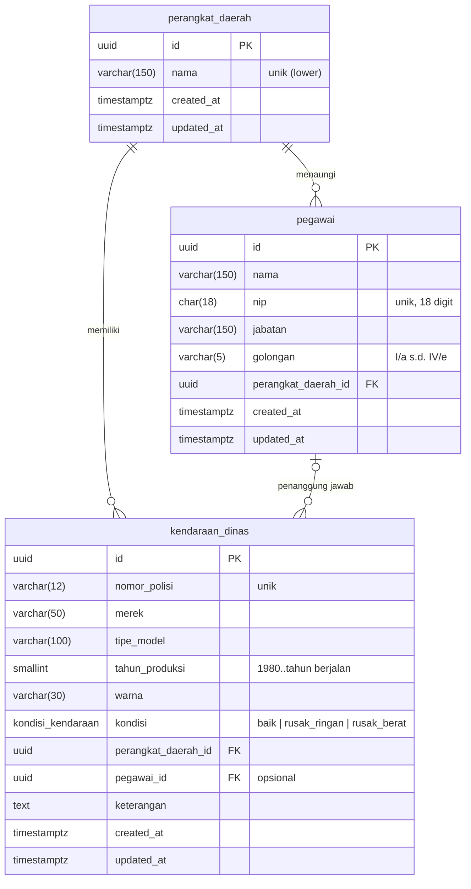

# Ujian Praktek Junior Programmer - BPAD

## SIM-KDO — Aplikasi Pengelolaan Kendaraan Dinas Operasional

Aplikasi ini dibangun menggunakan VSCode + Antigravity dengan model Gemini Flash 3.8, Argon, Claude Opus 5.5

Aplikasi web untuk pendataan **kendaraan dinas operasional (KDO)** milik perangkat daerah:

1. Mengetahui **kondisi** setiap kendaraan (Baik, Rusak Ringan, Rusak Berat).
2. Mengetahui **perangkat daerah** pemilik/pengguna kendaraan.
3. Mencatat **pegawai penanggung jawab** penggunaan kendaraan.

> Status: **Fase 0–5 selesai** — CRUD lengkap Perangkat Daerah, Pegawai, Kendaraan Dinas,
> dashboard ringkasan, dokumentasi OpenAPI, dan test backend/frontend.

## Fitur

- **Dashboard** — kartu ringkasan (total kendaraan, Baik / Rusak Ringan / Rusak Berat, tanpa
  penanggung jawab, total pegawai & perangkat daerah) dan tabel rekap kondisi per perangkat daerah.
  Setiap angka dapat diklik untuk membuka daftar kendaraan dengan filter terkait.
- **Kendaraan Dinas** — daftar dengan pencarian (nomor polisi/merek/tipe; `B1234` cocok dengan
  `B 1234 ABC`), filter kondisi, perangkat daerah, tahun produksi, dan "tanpa penanggung jawab";
  sort & pagination. Kondisi tampil sebagai badge berwarna (hijau/kuning/merah) yang sekaligus
  menjadi aksi cepat **ubah kondisi** (`PATCH`). Form: nomor polisi otomatis huruf besar &
  dinormalisasi; dropdown penanggung jawab **dapat dicari** dan hanya berisi pegawai dari perangkat
  daerah terpilih (nama + NIP + jabatan), otomatis dikosongkan saat perangkat daerah diganti.
- **Pegawai** — pencarian nama/NIP, filter perangkat daerah & golongan, sort nama/golongan (urut
  jenjang I/a → IV/e), input NIP 18 digit, halaman detail berisi kendaraan yang dipegang.
- **Perangkat Daerah** — daftar dengan jumlah pegawai & kendaraan, detail dengan rekap kondisi,
  daftar pegawai, dan daftar kendaraan.
- **UX** — sidebar yang menjadi drawer di layar kecil, loading skeleton, empty state, toast,
  dialog konfirmasi hapus (pesan penolakan relasi dari server tampil di dialog), error validasi
  backend tampil per field, filter/pencarian/halaman tersimpan di query string URL, pencarian
  dengan debounce 300 ms.

---

## Tech Stack

| Lapisan                   | Teknologi                                                                                                                   |
| ------------------------- | --------------------------------------------------------------------------------------------------------------------------- |
| Runtime & package manager | Bun 1.4 (workspaces)                                                                                                        |
| Backend                   | Elysia 1.4, TypeScript strict, Drizzle ORM + drizzle-kit, postgres.js, TypeBox (`t`), `@elysiajs/cors`, `@elysiajs/openapi` |
| Frontend                  | Vue 3.5 (`<script setup>`), Vite 8, Pinia 3, Vue Router 4, Tailwind CSS 4, VeeValidate + Zod, Axios                         |
| Database                  | PostgreSQL 17 (kompatibel 15+), ekstensi `pg_trgm`                                                                          |
| Testing                   | `bun test` (backend, DB test terpisah), Vitest + Vue Test Utils (frontend)                                                  |
| Lint/format               | Biome                                                                                                                       |
| Infrastruktur             | Docker multi-stage, docker-compose (postgres, api, web)                                                                     |

---

## Menjalankan Secara Lokal

Prasyarat: **Bun ≥ 1.4** dan **Docker** (untuk PostgreSQL).

```bash
cp .env.example .env
```

```bash
bun install
```

```bash
docker compose up -d postgres
```

```bash
bun run db:migrate
```

```bash
bun run db:seed
```

```bash
bun run dev
```

- Frontend: http://localhost:5173
- API: http://localhost:3000/api/v1
- Dokumentasi OpenAPI: http://localhost:3000/docs

Menjalankan backend/frontend secara terpisah: `bun run dev:api` dan `bun run dev:web`.

### Menjalankan seluruhnya via Docker

```bash
docker compose up -d --build
```

Container `api` otomatis menjalankan migrasi lalu seeder (idempoten, dapat dimatikan dengan
`RUN_SEED=false`). Frontend tersedia di http://localhost:5173 dan API di http://localhost:3000.

### Perintah

| Perintah (dari root)              | Fungsi                                              |
| --------------------------------- | --------------------------------------------------- |
| `bun run dev`                     | Menjalankan API (watch) & frontend (Vite) bersamaan |
| `bun run build`                   | Type-check & build backend + frontend               |
| `bun run start`                   | Menjalankan hasil build backend                     |
| `bun run test`                    | `bun test` backend + Vitest frontend                |
| `bun run db:generate`             | Membuat file migrasi dari perubahan `schema.ts`     |
| `bun run db:migrate`              | Menjalankan migrasi                                 |
| `bun run db:seed`                 | Mengisi data contoh (idempoten)                     |
| `bun run lint` / `bun run format` | Biome check / perbaikan otomatis                    |

### Testing

- **Backend** (`bun test`, 53 test): validasi NIP, golongan, nomor polisi, tahun produksi; aturan
  penanggung jawab satu perangkat daerah; penolakan hapus/pindah yang masih berelasi; duplikasi
  → 409; pagination, filter, sort, dan agregasi dashboard.
- **Frontend** (Vitest, 27 test): store Pinia (aksi CRUD dengan API di-mock, respons usang,
  refresh dashboard), `PenanggungJawabSelect` (dependen PD, debounce, pilih/kosongkan), form
  kendaraan (normalisasi nomor polisi, PD diganti → penanggung jawab dikosongkan, error backend per
  field), dan helper query string.

Test backend memakai database **terpisah** (`TEST_DATABASE_URL`, default `kdo_test`) yang dibuat
otomatis oleh `docker/postgres/init.sql` saat volume Postgres pertama kali dibuat. Preload test
menjalankan migrasi dan menolak berjalan bila nama database tidak mengandung `test`.

Jika volume Postgres sudah ada sebelum file init ditambahkan, buat manual:

```bash
docker compose exec postgres psql -U kdo -c "CREATE DATABASE kdo_test"
```

---

## Arsitektur

```
.
├── backend/                 # Elysia API
│   ├── src/
│   │   ├── index.ts         # bootstrap: listen + graceful shutdown
│   │   ├── app.ts           # createApp(): plugin, CORS, OpenAPI, error handler, router /api/v1
│   │   ├── config/env.ts    # baca & validasi env
│   │   ├── db/              # client, schema Drizzle, migrations/, migrate.ts, seed.ts
│   │   ├── lib/             # errors, error-handler, response, pagination, nomor-polisi
│   │   └── modules/         # per entitas: routes → service → repository (+ model.ts skema t)
│   └── tests/               # bun test (setup.ts memakai DB test terpisah)
├── frontend/                # Vue 3 SPA
│   └── src/
│       ├── api/             # instance axios terpusat + modul API per entitas
│       ├── stores/          # Pinia setup store per entitas (pola bersama di stores/crud.ts)
│       ├── views/           # Dashboard, kendaraan/, pegawai/, perangkat-daerah/ (List, Form, Detail)
│       ├── components/      # ui/ (DataTable, Pagination, Modal, ConfirmDialog, …), kendaraan/, layout/
│       ├── composables/     # useQueryFilters, useDebounce, useToast, useConfirmDelete
│       ├── schemas/         # skema Zod form
│       └── router/ types/ utils/
├── docker/postgres/init.sql # membuat database test
├── docker-compose.yml
└── .env.example
```

**Backend:** `routes` (validasi HTTP via TypeBox) → `service` (aturan bisnis, transaksi) →
`repository` (query Drizzle). Error domain (`NotFoundError`, `DuplicateError`,
`RelationInUseError`, `InvalidPenanggungJawabError`, …) ditangani terpusat di `onError`, termasuk
pemetaan error PostgreSQL (`23505` → `DATA_DUPLIKAT`). Stack trace tidak pernah dikirim ke client.

**Frontend:** komponen → store Pinia → modul `api/` → instance Axios. Interceptor Axios
menormalisasi error menjadi `ApiError` (dengan `fieldErrors` untuk ditampilkan per field di form).

### Format Response

```json
{ "success": true, "data": {}, "meta": { "page": 1, "per_page": 10, "total": 57, "total_pages": 6 } }
{ "success": false, "error": { "code": "VALIDASI_GAGAL", "message": "Data tidak valid", "details": [{ "field": "nip", "message": "NIP harus 18 digit angka" }] } }
```

| Kode                           | HTTP |
| ------------------------------ | ---- |
| `VALIDASI_GAGAL`               | 422  |
| `TIDAK_DITEMUKAN`              | 404  |
| `DATA_DUPLIKAT`                | 409  |
| `RELASI_MASIH_DIGUNAKAN`       | 409  |
| `PENANGGUNG_JAWAB_TIDAK_VALID` | 422  |
| `KESALAHAN_SERVER`             | 500  |

---

## Diagram Relasi Entitas (ERD)



Semua foreign key memakai `ON DELETE RESTRICT`. Index: seluruh FK, `kendaraan_dinas(kondisi)`,
`pegawai(nama)`, unique `lower(perangkat_daerah.nama)`, serta index GIN trigram untuk pencarian
`nama`, `nomor_polisi`, `merek`, dan `tipe_model`.

---

## Endpoint API (prefix `/api/v1`)

| Method | Endpoint | Keterangan |
| --- | --- | --- |
| GET | `/perangkat-daerah` | list + `jumlah_pegawai` & `jumlah_kendaraan`; `search`, `sort` (`nama`, `jumlah_pegawai`, `jumlah_kendaraan`, `created_at`) |
| GET | `/perangkat-daerah/:id` | detail + `rekap_kondisi` |
| POST | `/perangkat-daerah` | tambah |
| PUT | `/perangkat-daerah/:id` | ubah |
| DELETE | `/perangkat-daerah/:id` | hapus (409 bila masih memiliki pegawai/kendaraan) |
| GET | `/pegawai` | list; filter `perangkat_daerah_id`, `golongan`; sort `nama`, `golongan`, `nip`, `jabatan` |
| GET | `/pegawai/:id` | detail + `perangkat_daerah` + `kendaraan` yang dipegang |
| POST | `/pegawai` | tambah |
| PUT | `/pegawai/:id` | ubah (pindah PD ditolak bila masih penanggung jawab) |
| DELETE | `/pegawai/:id` | hapus (409 bila masih penanggung jawab) |
| GET | `/kendaraan` | list; filter `kondisi`, `perangkat_daerah_id`, `pegawai_id`, `tahun_produksi`, `tanpa_penanggung_jawab`; sort `nomor_polisi`, `merek`, `tipe_model`, `tahun_produksi`, `kondisi` |
| GET | `/kendaraan/:id` | detail + `perangkat_daerah` + `penanggung_jawab` |
| POST | `/kendaraan` | tambah |
| PUT | `/kendaraan/:id` | ubah |
| PATCH | `/kendaraan/:id/kondisi` | ubah kondisi saja |
| DELETE | `/kendaraan/:id` | hapus |
| GET | `/dashboard/ringkasan` | angka ringkasan + rekap kondisi per perangkat daerah (agregasi SQL `COUNT … FILTER` + `GROUP BY`) |
| GET | `/health` | health check termasuk koneksi database |

Semua list menerima `page`, `per_page` (maks 100), `search`, dan `sort` (awali `-` untuk menurun,
mis. `-tahun_produksi`). ID di path divalidasi sebagai UUID (format salah → 422). Dokumentasi
interaktif lengkap tersedia di `/docs`.

---

## Aturan Bisnis

- Penanggung jawab kendaraan **harus** pegawai dari perangkat daerah yang sama
  (`PENANGGUNG_JAWAB_TIDAK_VALID`).
- Mengubah perangkat daerah kendaraan dengan penanggung jawab yang tidak lagi sesuai ditolak.
- Hapus perangkat daerah ditolak (409 `RELASI_MASIH_DIGUNAKAN`) bila masih memiliki pegawai atau
  kendaraan; pesan menyebutkan jumlahnya.
- Hapus pegawai ditolak (409) bila masih menjadi penanggung jawab; pesan menyebutkan nomor polisi.
- Pindah perangkat daerah pegawai ditolak (409 `RELASI_MASIH_DIGUNAKAN`) bila masih menjadi
  penanggung jawab kendaraan di perangkat daerah lama; pesan menyebutkan nomor polisinya.
- Aturan lintas entitas dijalankan di service layer di dalam **transaksi**; baris yang dirujuk
  dikunci (`FOR UPDATE` / `FOR SHARE`) agar tidak berubah atau terhapus di tengah proses.
  `ON DELETE RESTRICT` di database menjadi pengaman kedua.
- Duplikasi `nomor_polisi`, `nip`, atau `nama` perangkat daerah → 409 `DATA_DUPLIKAT` + nama field.

---

## Asumsi & Keputusan

- **Monorepo di root repositori** (bukan subfolder `kdo-app/`), karena repositori ini khusus untuk
  aplikasi tersebut.
- **Versi stabil** dipilih daripada rilis RC/next: Elysia 1.4 (bukan 2.0 RC), Vue Router 4 (sesuai
  spesifikasi), Pinia 3, TypeScript 5.9 (TypeScript 7 belum didukung `vue-tsc`), Zod 3.25 (peer
  dependency `@vee-validate/zod`).
- **Pola nomor polisi**: spesifikasi menulis `^[A-Z]{1,2} \d{1,4} [A-Z]{0,3}$`, yang mewajibkan spasi
  di akhir bila seri huruf kosong. Diterapkan sebagai `^[A-Z]{1,2} \d{1,4}( [A-Z]{1,3})?$` sehingga
  `B 1234` valid tanpa spasi di akhir. Input seperti `b1234abc` dinormalisasi menjadi `B 1234 ABC`.
- **Tahun produksi**: CHECK constraint database membatasi `1980..2100` (constraint harus
  deterministik), sedangkan batas atas tepat "tahun berjalan" (zona Asia/Jakarta) divalidasi di API.
- **`updated_at`** diperbarui oleh Drizzle (`$onUpdate`) dan trigger database sebagai pengaman kedua.
- **`app.ts` terpisah dari `index.ts`** agar aplikasi bisa diuji lewat `app.handle()` tanpa membuka
  port.
- File `.env` tunggal di root dipakai backend (`--env-file=../.env`) dan frontend (`envDir`).
- Lint & format memakai **Biome** (satu alat untuk TS; file `.vue` dicek `vue-tsc`).
- **`per_page` > 100 di-clamp menjadi 100** (bukan ditolak), begitu juga `page` < 1 menjadi 1.
- **Filter enum di query** (`kondisi`, `golongan`) divalidasi di service (nilai salah → 422).
  Elysia mengisi nilai default pada `t.UnionEnum` opsional di query string, sehingga skema query
  memakai string biasa.
- **Perangkat daerah/pegawai yang dirujuk tidak ada** saat tambah/ubah → 422 `VALIDASI_GAGAL`
  dengan detail field (`perangkat_daerah_id` / `pegawai_id`), bukan 404, karena kesalahan ada pada
  isi body.
- **`PUT` adalah penggantian penuh**: bila perangkat daerah kendaraan diganti sementara `pegawai_id`
  masih pegawai PD lama, request ditolak (`PENANGGUNG_JAWAB_TIDAK_VALID`). Form frontend otomatis
  mengosongkan penanggung jawab saat perangkat daerah diganti.
- **Form tambah/ubah berupa halaman** (`/…/baru`, `/…/:id/ubah`) agar dapat dibuka langsung lewat
  URL; konfirmasi hapus memakai dialog.
- **Fitur opsional** (autentikasi JWT, riwayat penanggung jawab, ekspor Excel/PDF, soft delete)
  belum dikerjakan karena hanya dikerjakan bila diminta.

---

## Roadmap

- [x] **Fase 0** — Setup monorepo, docker-compose, Elysia + Drizzle, skema & migrasi, seeder, Vue +
      Pinia + Router + Tailwind, layout dasar
- [x] **Fase 1** — Perangkat Daerah (API CRUD + test, store, halaman)
- [x] **Fase 2** — Pegawai (validasi NIP/golongan)
- [x] **Fase 3** — Kendaraan Dinas (aturan penanggung jawab, `PATCH kondisi`)
- [x] **Fase 4** — Dashboard ringkasan
- [x] **Fase 5** — Penyempurnaan UX, dokumentasi OpenAPI, README
